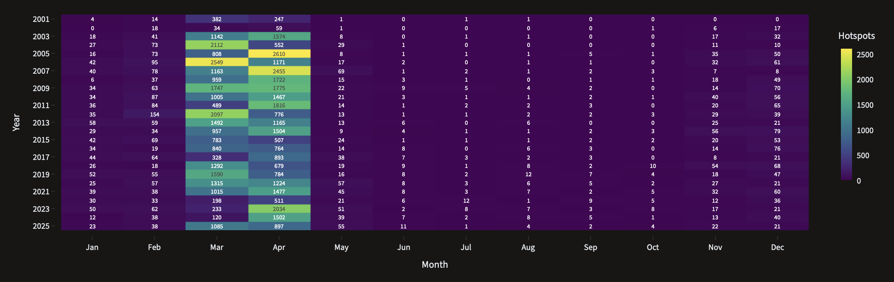

# MODIS and VIIRS Fire Calendar
Data pipeline harmonizing MODIS and VIIRS fire hotspot records into a consistent activity calendar (NASA Space Apps Challenge 2026)

Team: Hotspot Harmonization (solo)
Live app: https://modis-viirs-fire-calendar.streamlit.app

This project demonstrates a data pipeline as well as a web application that compares two different satellite fire records in Bangladesh with a MODIS calendar from 2000-2025 and a VIIRS overlap used for calibration from 2020-2025. It is aimed at emergency responders, land managers and scientists who need insight on fire activity. 
s


**Key Results**
- VIIRS and MODIS cannot be directly compared to one another. In 2025, VIIRS logged 7,830 detections against MODIS 2,163.
- A two-ratio conversion converted VIIRS counts to MODIS using one ratio for busy months and the other for quiet months. Ratios were calculated from 2020-2023 and tested on 2024 and 2025 which cut the average monthly error from **36.8 to 23.5** hotspots.
- SQL views in MySQL produce the same ratios (**0.2663 and 0.1639**).


**Pipeline**
```
FIRMS CSVs -> profile -> clean -> monthly counts -> calibrate -> validate -> Streamlit app
            -> load into MySQL -> SQL views (harmonized series)
```
- **Cleaning:** MODIS and VIIRS use different confidence scales so each sensor is filtered with its own rule as only vegetation fires are kept. 
- **App:** A heatmap of fire activity showcasing activity by both year and month. MODIS counts are applied where available and converted VIIRS counts to fill gaps.


**Method and Validation**

VIIRS displays more fires than MODIS so VIIRS counts have been converted to MODIS counts. Conversion was calculated from 2020-2023 and tested on 2024 and 2025. 

| Approach | Avg error / month |
|---|---|
| One ratio for all months | 36.8 |
| Log curve | 100.1 |
| **Two ratios (busy vs. quiet months)** | **23.5** |

Utilizing two ratios gave the closest match as busy and quiet months require different ratios. 


**Limitations**
- One country as well as two tested years (2024, 2025). The method is reasonable but no proof as of now of how well it works in other years or countries. 
- MODIS 2000 to 2002 is likely undercounted as only one MODIS satellite was operating. 
- App reads CSV files, not MySQL so SQL views and app are separate. 

**Next Steps**
- Test with more countries beyond Bangladesh 
- Add a region picker to the app

**Run it**
```bash
pip install -r requirements.txt
python3 src/clean_and_aggregate.py && python3 src/calibrate.py && python3 src/calibrate2.py
streamlit run app/app.py

# Loading into MySQL is optional 
mysql -u root -e "CREATE DATABASE IF NOT EXISTS fire_calendar;"
python3 src/load_mysql.py && mysql -u root fire_calendar < sql/views.sql
```

<sub><sub><sub>SI tools were utilized for code and data.</sub></sub></sub>